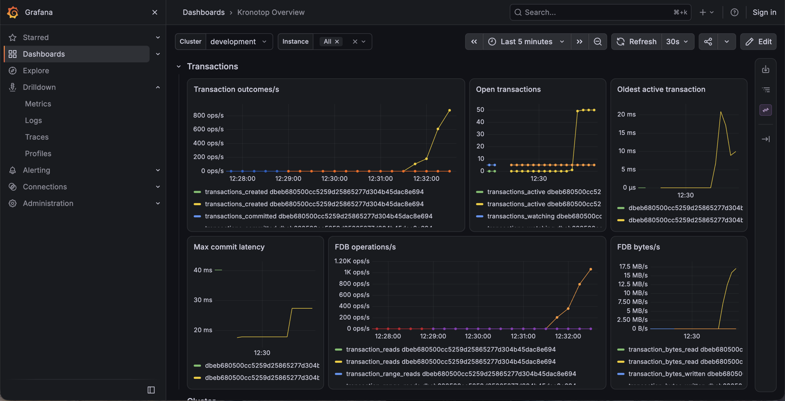

# Observability

Grafana dashboards for Kronotop. Import the JSON files in `grafana/` into your Grafana.



- `kronotop-overview.json`: cluster members, clients, traffic, transactions.
- `kronotop-jvm.json`: heap, non-heap, direct buffers, GC, allocation rate.
- `kronotop-data-models.json`: Bucket, ZMap, vector index and index maintenance activity.

## Requirements

- OTLP export enabled in Kronotop (`observability.otlp.enabled`, `observability.otlp.endpoint`).
- An OpenTelemetry Collector that receives OTLP/HTTP and exposes the Prometheus exporter with `resource_to_telemetry_conversion: enabled`.
- Prometheus scraping the collector, added to Grafana as a datasource with `uid: prometheus`.

For a local stack with collector, Prometheus and Grafana, see [docker/observability](../../docker/observability).

## Metric naming

Kronotop sends the numeric `INFO` fields. The Prometheus exporter in the collector builds the metric names:

- Every name starts with `kronotop_`.
- Counters: the word `total` is removed from the field name, then `_total` is added at the end.
- Byte values get `_bytes` at the end, before `_total`. If the field name already contains `bytes`, nothing is added.
- Fields with the value `-1`, text fields and `_human` fields are not sent.

## Labels

| Label                   | Value                                                                                                       |
|-------------------------|-------------------------------------------------------------------------------------------------------------|
| `kronotop_cluster_name` | Cluster name.                                                                                               |
| `instance`              | Member id. Comes from the `service.instance.id` resource attribute.                                         |
| `job`                   | Always `kronotop`. Comes from the `service.name` resource attribute.                                        |
| `service_version`       | Kronotop version.                                                                                           |
| `kronotop_run_id`       | One value per process. It changes on every restart. A new value means the counters started from zero again. |

## Querying

- Counters start at zero on restart. Use `rate()` or `increase()`, not the raw value.
- Gauges: use the raw value.
- Filter by `kronotop_cluster_name` and `instance`.

```promql
# Client commands per second on one cluster
rate(kronotop_external_commands_processed_total{kronotop_cluster_name="dev"}[1m])

# Heap allocation rate of one member
rate(kronotop_allocated_memory_bytes_total{instance="m1"}[1m])

# Heap usage ratio
kronotop_heap_used_memory_bytes / kronotop_heap_max_memory_bytes

# Restarts: more than 1 run id per instance in the time range means a restart
count by (instance) (count by (instance, kronotop_run_id) (kronotop_uptime_in_seconds))
```

The dashboards in [grafana](grafana/) have more examples.

## Exported fields

See [docs/connection/commands/info.md](../../docs/connection/commands/info.md) for what each field means.

### Server

| INFO field              | Prometheus name                        | Type    |
|-------------------------|----------------------------------------|---------|
| `uptime_in_seconds`     | `kronotop_uptime_in_seconds`           | gauge   |
| `process_cpu_time_msec` | `kronotop_process_cpu_time_msec_total` | counter |

### Kronotop

`stash_shards` is sent only when `stash.enabled` is true.

| INFO field       | Prometheus name           | Type  |
|------------------|---------------------------|-------|
| `known_members`  | `kronotop_known_members`  | gauge |
| `alive_members`  | `kronotop_alive_members`  | gauge |
| `bucket_shards`  | `kronotop_bucket_shards`  | gauge |
| `stash_shards`   | `kronotop_stash_shards`   | gauge |
| `primary_shards` | `kronotop_primary_shards` | gauge |
| `standby_shards` | `kronotop_standby_shards` | gauge |

### Clients

`clients_in_multi` is sent only when `stash.enabled` is true.

| INFO field               | Prometheus name                   | Type  |
|--------------------------|-----------------------------------|-------|
| `connected_clients`      | `kronotop_connected_clients`      | gauge |
| `clients_in_transaction` | `kronotop_clients_in_transaction` | gauge |
| `clients_in_multi`       | `kronotop_clients_in_multi`       | gauge |
| `snapshot_read_clients`  | `kronotop_snapshot_read_clients`  | gauge |
| `resp2_clients`          | `kronotop_resp2_clients`          | gauge |
| `resp3_clients`          | `kronotop_resp3_clients`          | gauge |

### Memory

`non_heap_max_memory` is usually `-1`, so it is usually missing.

| INFO field                     | Prometheus name                               | Type    |
|--------------------------------|-----------------------------------------------|---------|
| `heap_used_memory`             | `kronotop_heap_used_memory_bytes`             | gauge   |
| `heap_committed_memory`        | `kronotop_heap_committed_memory_bytes`        | gauge   |
| `heap_max_memory`              | `kronotop_heap_max_memory_bytes`              | gauge   |
| `non_heap_used_memory`         | `kronotop_non_heap_used_memory_bytes`         | gauge   |
| `non_heap_committed_memory`    | `kronotop_non_heap_committed_memory_bytes`    | gauge   |
| `non_heap_max_memory`          | `kronotop_non_heap_max_memory_bytes`          | gauge   |
| `direct_buffer_count`          | `kronotop_direct_buffer_count`                | gauge   |
| `direct_buffer_used_memory`    | `kronotop_direct_buffer_used_memory_bytes`    | gauge   |
| `direct_buffer_total_capacity` | `kronotop_direct_buffer_total_capacity_bytes` | gauge   |
| `mapped_buffer_count`          | `kronotop_mapped_buffer_count`                | gauge   |
| `mapped_buffer_total_capacity` | `kronotop_mapped_buffer_total_capacity_bytes` | gauge   |
| `netty_used_direct_memory`     | `kronotop_netty_used_direct_memory_bytes`     | gauge   |
| `netty_used_heap_memory`       | `kronotop_netty_used_heap_memory_bytes`       | gauge   |
| `total_allocated_memory`       | `kronotop_allocated_memory_bytes_total`       | counter |
| `gc_count`                     | `kronotop_gc_count_total`                     | counter |
| `gc_time_msec`                 | `kronotop_gc_time_msec_total`                 | counter |
| `gc_freed_memory`              | `kronotop_gc_freed_memory_bytes_total`        | counter |

### Threads

Only platform threads are counted. Virtual threads are not included.

| INFO field              | Prometheus name                  | Type    |
|-------------------------|----------------------------------|---------|
| `thread_count`          | `kronotop_thread_count`          | gauge   |
| `daemon_thread_count`   | `kronotop_daemon_thread_count`   | gauge   |
| `peak_thread_count`     | `kronotop_peak_thread_count`     | gauge   |
| `total_started_threads` | `kronotop_started_threads_total` | counter |

### Traffic

`external_commands_succeeded` and `internal_commands_succeeded` are not sent.

| INFO field                          | Prometheus name                              | Type    |
|-------------------------------------|----------------------------------------------|---------|
| `external_total_commands_processed` | `kronotop_external_commands_processed_total` | counter |
| `external_commands_failed`          | `kronotop_external_commands_failed_total`    | counter |
| `external_read_bytes`               | `kronotop_external_read_bytes_total`         | counter |
| `external_written_bytes`            | `kronotop_external_written_bytes_total`      | counter |
| `internal_total_commands_processed` | `kronotop_internal_commands_processed_total` | counter |
| `internal_commands_failed`          | `kronotop_internal_commands_failed_total`    | counter |
| `internal_read_bytes`               | `kronotop_internal_read_bytes_total`         | counter |
| `internal_written_bytes`            | `kronotop_internal_written_bytes_total`      | counter |

### Transactions

`transactions_closed_without_commit`, `avg_commit_latency_usec` and `avg_transaction_duration_usec` are not sent.

| INFO field                       | Prometheus name                             | Type    |
|----------------------------------|---------------------------------------------|---------|
| `transactions_created`           | `kronotop_transactions_created_total`       | counter |
| `transactions_active`            | `kronotop_transactions_active`              | gauge   |
| `transactions_watching`          | `kronotop_transactions_watching`            | gauge   |
| `oldest_active_transaction_usec` | `kronotop_oldest_active_transaction_usec`   | gauge   |
| `transactions_committed`         | `kronotop_transactions_committed_total`     | counter |
| `transactions_conflicted`        | `kronotop_transactions_conflicted_total`    | counter |
| `transactions_commit_failed`     | `kronotop_transactions_commit_failed_total` | counter |
| `transactions_rolled_back`       | `kronotop_transactions_rolled_back_total`   | counter |
| `transaction_reads`              | `kronotop_transaction_reads_total`          | counter |
| `transaction_range_reads`        | `kronotop_transaction_range_reads_total`    | counter |
| `transaction_writes`             | `kronotop_transaction_writes_total`         | counter |
| `transaction_deletes`            | `kronotop_transaction_deletes_total`        | counter |
| `transaction_range_deletes`      | `kronotop_transaction_range_deletes_total`  | counter |
| `transaction_mutations`          | `kronotop_transaction_mutations_total`      | counter |
| `transaction_bytes_read`         | `kronotop_transaction_bytes_read_total`     | counter |
| `transaction_bytes_written`      | `kronotop_transaction_bytes_written_total`  | counter |
| `max_commit_latency_usec`        | `kronotop_max_commit_latency_usec`          | gauge   |

### Tasks

| INFO field      | Prometheus name          | Type  |
|-----------------|--------------------------|-------|
| `task_count`    | `kronotop_task_count`    | gauge |
| `running_tasks` | `kronotop_running_tasks` | gauge |

### Volume

The `volumeN` lines are not sent.

| INFO field     | Prometheus name         | Type  |
|----------------|-------------------------|-------|
| `volume_count` | `kronotop_volume_count` | gauge |

### Bucket

`index_maintenance_last_run` is not sent.

| INFO field                            | Prometheus name                                      | Type    |
|---------------------------------------|------------------------------------------------------|---------|
| `plan_cache_size`                     | `kronotop_plan_cache_size`                           | gauge   |
| `plan_cache_hits`                     | `kronotop_plan_cache_hits_total`                     | counter |
| `plan_cache_misses`                   | `kronotop_plan_cache_misses_total`                   | counter |
| `open_cursors`                        | `kronotop_open_cursors`                              | gauge   |
| `bucket_inserts`                      | `kronotop_bucket_inserts_total`                      | counter |
| `bucket_queries`                      | `kronotop_bucket_queries_total`                      | counter |
| `bucket_updates`                      | `kronotop_bucket_updates_total`                      | counter |
| `bucket_deletes`                      | `kronotop_bucket_deletes_total`                      | counter |
| `bucket_advances`                     | `kronotop_bucket_advances_total`                     | counter |
| `bucket_vector_searches`              | `kronotop_bucket_vector_searches_total`              | counter |
| `bucket_purges`                       | `kronotop_bucket_purges_total`                       | counter |
| `bucket_removes`                      | `kronotop_bucket_removes_total`                      | counter |
| `index_maintenance_workers`           | `kronotop_index_maintenance_workers`                 | gauge   |
| `index_maintenance_processed_entries` | `kronotop_index_maintenance_processed_entries_total` | counter |
| `index_maintenance_retried_conflicts` | `kronotop_index_maintenance_retried_conflicts_total` | counter |

### Vector

| INFO field               | Prometheus name                     | Type    |
|--------------------------|-------------------------------------|---------|
| `vector_indexes`         | `kronotop_vector_indexes`           | gauge   |
| `vector_bytes_used`      | `kronotop_vector_bytes_used`        | gauge   |
| `vector_pending_retries` | `kronotop_vector_pending_retries`   | gauge   |
| `vector_retried_ops`     | `kronotop_vector_retried_ops_total` | counter |

### ZMap

| INFO field           | Prometheus name                   | Type    |
|----------------------|-----------------------------------|---------|
| `zmap_sets`          | `kronotop_zmap_sets_total`        | counter |
| `zmap_gets`          | `kronotop_zmap_gets_total`        | counter |
| `zmap_range_reads`   | `kronotop_zmap_range_reads_total` | counter |
| `zmap_deletes`       | `kronotop_zmap_deletes_total`     | counter |
| `zmap_mutations`     | `kronotop_zmap_mutations_total`   | counter |
| `zmap_watches`       | `kronotop_zmap_watches`           | gauge   |
| `zmap_watched_keys`  | `kronotop_zmap_watched_keys`      | gauge   |
| `zmap_watch_waiters` | `kronotop_zmap_watch_waiters`     | gauge   |
| `zmap_watch_fires`   | `kronotop_zmap_watch_fires_total` | counter |
